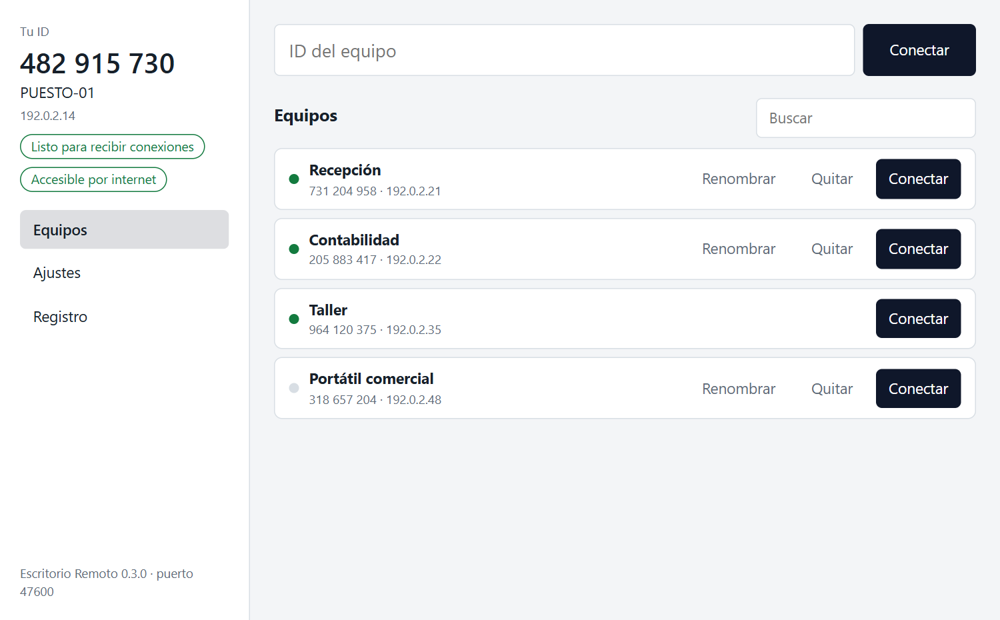

# Escritorio Remoto

Remote desktop for Windows: type a computer's ID and connect, whether it is on your network or not. Direct, end-to-end encrypted, with no server and no accounts.

<picture>
  <source media="(prefers-color-scheme: dark)" srcset="docs/inicio-oscuro.png">
  
</picture>

## How it works

- Each computer has a 9-digit ID derived from its own key with a slow function (scrypt), so imitating an ID is very expensive. After the first connection the full key is pinned.
- The local network and the internet are tried at the same time; the first one to answer wins.
- Over the internet, computers find each other through [HyperDHT](https://github.com/holepunchto/hyperdht) and open a direct path with UDP hole punching. No ports to open, no server of your own.
- Session traffic uses its own channel: X25519 + AES-256-GCM with fresh keys per connection and Ed25519 identities.
- Anyone who knows the ID can *ask* for access. Getting in needs someone to accept on screen, or the computer's password.

It cannot connect when a network blocks UDP, or when both networks use NATs that change port on every connection. The protocol is custom and has not been externally audited.

## Run it

Download it from [Releases](https://github.com/Serberar/escritorio-remoto/releases/latest). It is not code-signed, so Windows will warn you. From source:

```powershell
npm install
npm start
```

## Tests

`npm test` (41 tests), `npm run por-id` (full app over the internet), `npm run resilience`, and a [scheduled test between two real networks](.github/workflows/internet.yml).

More details in the [Spanish README](README.md). [MIT](LICENSE), Copyright © 2026 Sergio Bernabé.
