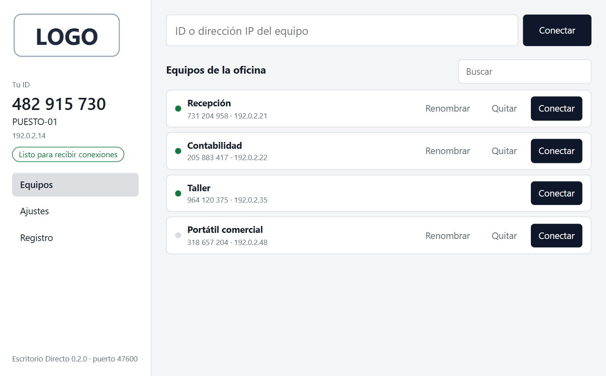

# Escritorio Directo

Escritorio remoto para la red de una empresa. Conexión directa de equipo a equipo, cifrada de extremo a extremo, sin servidor ni cuentas.

<picture>
  <source media="(prefers-color-scheme: dark)" srcset="docs/inicio-oscuro.png">
  
</picture>

**Lo interesante por dentro**

- Protocolo propio sobre TCP: X25519 + AES-256-GCM, claves nuevas en cada conexión ([src/channel.js](src/channel.js)).
- Descubrimiento de equipos por UDP, sin servidor central ([src/discovery.js](src/discovery.js)).
- Ratón y teclado con la API de Windows mediante FFI, sin módulos nativos que compilar ([src/input-win.js](src/input-win.js)).
- Electron endurecido: CSP sin orígenes externos, canales IPC por ventana y fuses.
- Una sola dependencia en ejecución. 31 pruebas, más pruebas de extremo a extremo y de resiliencia.

Los nombres e IP de la captura son de ejemplo y el logo es un hueco para el de cada empresa.

## Qué archivo usar

| | Portable | Instalador |
| --- | --- | --- |
| Uso | Doble clic, sin instalar | Equipos fijos |
| Administrador | No para abrirlo ni para conectarte a otros | Sí |
| Firewall | Windows pregunta la primera vez que recibe conexiones; aceptar suele pedir administrador | Abre los puertos él solo |

El portable se descomprime una vez en `%LOCALAPPDATA%\com.example.escritoriodirecto` (unos 10 s) y después abre al instante. Al cambiar de versión, Windows vuelve a preguntar por el firewall.
Para permitirlo en muchos equipos, por GPO o como administrador: abrir TCP 47600 y UDP 47601 de entrada en redes privadas y de dominio.

## Cambiar la marca

Está en `branding/`: `branding.json` (nombre y colores claro/oscuro), `logo.png`, `logo-dark.png` e `icon.png` (512 x 512). El logo incluido es un hueco: pon el de tu empresa.
No cambies `appId` ni `appName` una vez repartido: equivaldría a otro programa.
Si cambias los puertos en el JSON, cámbialos también en `scripts/installer.nsh`.

## Generar los ejecutables

```powershell
npm install
```
```powershell
npm run dist
```

Salen en `dist/` el instalador y el portable. No están firmados: Windows SmartScreen avisará al abrirlos. Para evitarlo hace falta un certificado de firma de código.

## Poner en marcha

1. Ábrelo en el primer equipo y pulsa "Generar clave nueva". Guárdala como una contraseña maestra.
2. Ábrelo en los demás y pega la misma clave. Los equipos de la misma red aparecen solos.
3. En los equipos a los que quieras entrar sin que nadie acepte: Ajustes > Acceso sin supervisión, y "Iniciar con Windows".

## Redes

| Situación | Qué hacer |
| --- | --- |
| Misma red | Nada. Aparecen solos |
| Otra VLAN o sede con ruta | Escribir la IP la primera vez; luego queda guardado |
| Desde casa | VPN (por ejemplo WireGuard o Tailscale) y escribir la IP de la VPN |

Puertos: TCP 47600 (sesión) y UDP 47601 (descubrimiento). El instalador los abre solo en redes privadas o de dominio. Si la red o la VPN figura como pública en Windows, cámbiala a privada.
No abras el puerto en el router hacia internet: usa VPN.

## Seguridad

- Cifrado extremo a extremo: X25519 + AES-256-GCM, con claves nuevas en cada conexión.
- Sin la clave de empresa no se completa la conexión. Además hace falta aceptación en pantalla o la contraseña del equipo.
- El ID sale de la clave propia del equipo. Conectando por ID se comprueba que responde ese equipo.
- Máximo de intentos de contraseña: 5 por equipo y 20 en total cada 10 minutos.
- Durante la sesión el equipo controlado muestra quién está conectado y puede cortar o quitar permisos. Si esa ventana se cae o se cuelga, la sesión se corta sola (como mucho en unos 12 s).
- Los secretos se guardan cifrados con la cuenta de Windows. Cada equipo lleva su registro local, con tope de tamaño.
- Entra por ID siempre que puedas: comprueba la identidad del equipo. Entrando por IP con contraseña, alguien de la empresa que suplantara esa IP podría intentar adivinarla sin conexión.
- Si un empleado se va o se pierde un equipo, cambia la clave de empresa en todos.
- El protocolo es propio y no ha pasado una auditoría externa.

## Límites de esta versión

- Solo Windows de 64 bits, con una sesión de usuario iniciada. No controla la pantalla de bloqueo, el inicio de sesión ni los avisos de UAC.
- No controla ventanas abiertas como administrador salvo que este programa también se ejecute como administrador.
- Sin Ctrl+Alt+Supr, audio, impresión remota, grabación ni reinicio remoto.
- Portapapeles solo de texto. Archivos sueltos, no carpetas.
- El teclado se envía por posición de tecla: los dos equipos deben usar la misma distribución.

## Si algo falla

- "Registro" > "Abrir carpeta de registros": `audit.jsonl` (quién se conectó) y `app.log` (errores del programa).
- Configuración dañada: se recupera sola de la copia; la dañada queda como `config.danada-...json`.
- "Windows no pudo abrir las claves": vuelve a poner la clave de empresa y la contraseña. El ID del equipo cambia.
- Error grave: se apunta, se cortan las sesiones y el programa se reinicia solo (una vez por minuto como mucho).
- Un equipo sale con "tiene mal la fecha u hora": corrígela en ese equipo.
- Con dos usuarios de Windows abiertos a la vez en un PC, solo el primero recibe conexiones.

## Pruebas

- `npm test`: núcleo y regresiones.
- `npm run e2e`: dos copias reales en este equipo; mueve el ratón un instante.
- `npm run resilience`: provoca caídas, cuelgues, configuración dañada, red lenta, etc.

## Licencia

[MIT](LICENSE)
