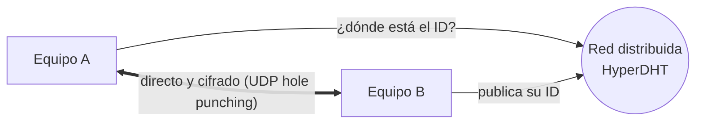

# Escritorio Remoto

**Español** · [English](README.en.md)

[](https://github.com/Serberar/escritorio-remoto/actions/workflows/ci.yml) [](https://github.com/Serberar/escritorio-remoto/releases/latest)

Escritorio remoto para Windows: escribes el ID de un equipo y te conectas, esté en tu red o en otra. Directo, cifrado de extremo a extremo y sin servidor ni cuentas.

<picture>
  <source media="(prefers-color-scheme: dark)" srcset="docs/inicio-oscuro.png">
  
</picture>

**Lo interesante por dentro**

- Protocolo propio sobre TCP: X25519 + AES-256-GCM, claves nuevas en cada conexión ([src/channel.js](src/channel.js)).
- Conexión por ID entre redes distintas con UDP hole punching, sin abrir puertos ([src/wan.js](src/wan.js)), y descubrimiento por UDP en la red local ([src/discovery.js](src/discovery.js)).
- Ratón y teclado con la API de Windows mediante FFI, sin módulos nativos que compilar ([src/input-win.js](src/input-win.js)).
- Electron endurecido: CSP sin orígenes externos, canales IPC por ventana y fuses.
- Dos dependencias directas en ejecución. 41 pruebas, más pruebas con el programa completo, de resiliencia y [entre dos redes reales](.github/workflows/internet.yml).

Los nombres e IP de la captura son de ejemplo.

## Qué archivo usar

| | Portable | Instalador |
| --- | --- | --- |
| Uso | Doble clic, sin instalar | Equipos fijos |
| Administrador | No para abrirlo ni para conectarte a otros | Sí |
| Firewall | Windows pregunta la primera vez que recibe conexiones; aceptar suele pedir administrador | Abre los puertos él solo |

El portable se descomprime una vez en `%LOCALAPPDATA%\com.example.escritorioremoto` (unos 10 s) y después abre al instante. Al cambiar de versión, Windows vuelve a preguntar por el firewall.
Para permitirlo en muchos equipos, por GPO o como administrador: abrir TCP 47600 y UDP 47601 de entrada en redes privadas y de dominio.

## Cambiar la marca

Está en `branding/`: `branding.json` (nombre y colores claro/oscuro) e `icon.png` (512 x 512).
No cambies `appId` ni `appName` una vez repartido: equivaldría a otro programa.
Si cambias los puertos en el JSON, cámbialos también en `scripts/installer.nsh`.

## Generar los ejecutables

```powershell
npm install
```
```powershell
npm run dist
```

Salen en `dist/` el instalador y el portable. No están firmados: Windows SmartScreen avisará al abrirlos. Para evitarlo hace falta un certificado de firma de código.

## Poner en marcha

1. Ábrelo en los dos equipos. No hay cuentas ni claves que repartir: cada equipo enseña su **ID de 9 cifras**.
2. Escribe el ID del otro y pulsa Conectar. Da igual que esté en la misma oficina, en otra o en casa.
3. En el otro equipo, alguien acepta en pantalla. Para entrar sin que haya nadie: Ajustes > Acceso sin supervisión, y "Iniciar con Windows".

Los equipos de la misma red aparecen solos en la lista, y los demás se quedan guardados tras la primera conexión.

## Cómo se encuentran por internet



- Primero se prueba la red local y, a la vez, internet. Gana la vía que antes responda.
- No hay que abrir puertos ni tener servidor: los dos routers se abren paso con ayuda de [HyperDHT](https://github.com/holepunchto/hyperdht), una red pública. Por ella solo pasa la presentación; la sesión va directa entre los dos equipos.
- **Cuándo no se puede:** si una red bloquea UDP, o si las dos usan un NAT que cambia de puerto en cada conexión (algunas redes móviles y de empresa). El programa lo dice; en ese caso, usa otra red o una VPN.
- Se puede desactivar en Ajustes y dejarlo solo en red local. También se puede escribir una dirección IP.

Puertos en red local: TCP 47600 (sesión) y UDP 47601 (descubrimiento). El instalador los abre en redes privadas o de dominio. No abras ninguno en el router.

## Seguridad

- Cifrado extremo a extremo: X25519 + AES-256-GCM, con claves nuevas en cada conexión. La red distribuida no ve nada de la sesión.
- Quien sepa tu ID puede **pedir** acceso. Para entrar hace falta que alguien acepte en pantalla o la contraseña del equipo.
- El ID sale de la clave propia del equipo con una función lenta (scrypt): fabricar otra clave con tu mismo ID cuesta miles de horas de procesador. Tras la primera conexión se guarda la clave completa y, si cambia, se rechaza.
- Contraseña: 5 intentos por equipo y 20 en total cada 10 minutos; las fáciles no se admiten. Peticiones en pantalla: tras 3 rechazos se ignora a ese equipo 30 minutos, y hay un tope total.
- Durante la sesión el equipo controlado muestra quién está conectado y puede cortar o quitar permisos. Si esa ventana se cae o se cuelga, la sesión se corta sola (como mucho en unos 12 s).
- Los secretos se guardan cifrados con la cuenta de Windows. Cada equipo lleva su registro local, con tope de tamaño.
- Entrando por IP no se comprueba el ID: hazlo solo en redes de confianza.
- El protocolo es propio y no ha pasado una auditoría externa.

## Límites de esta versión

- Solo Windows de 64 bits, con una sesión de usuario iniciada. No controla la pantalla de bloqueo, el inicio de sesión ni los avisos de UAC.
- No controla ventanas abiertas como administrador salvo que este programa también se ejecute como administrador.
- Sin Ctrl+Alt+Supr, audio, impresión remota, grabación ni reinicio remoto.
- Portapapeles solo de texto. Archivos sueltos, no carpetas.
- El teclado se envía por posición de tecla: los dos equipos deben usar la misma distribución.

## Si algo falla

- "Registro" > "Abrir carpeta de registros": `audit.jsonl` (quién se conectó) y `app.log` (errores del programa).
- Configuración dañada: se recupera sola de la copia; la dañada queda como `config.danada-...json`.
- "Windows no pudo abrir las claves": vuelve a poner la contraseña. El ID del equipo cambia.
- "Sin conexión por internet": no hay internet o la red bloquea UDP. En la red local sigue funcionando.
- Error grave: se apunta, se cortan las sesiones y el programa se reinicia solo (una vez por minuto como mucho).
- Un equipo sale con "tiene mal la fecha u hora": corrígela en ese equipo.
- Con dos usuarios de Windows abiertos a la vez en un PC, solo el primero recibe conexiones.

## Pruebas

- `npm test`: núcleo y regresiones.
- `npm run e2e`: dos copias reales en este equipo; mueve el ratón un instante.
- `npm run por-id`: dos copias que no se ven en la red local se conectan por internet.
- `npm run internet -- host <sala>` y `npm run internet -- visor <sala>`: entre dos equipos de redes distintas.
- `npm run resilience`: provoca caídas, cuelgues, configuración dañada, red lenta, etc.

## Licencia

[MIT](LICENSE), Copyright © 2026 Sergio Bernabé

## Autor

Diseñado y programado por Sergio Bernabé.
